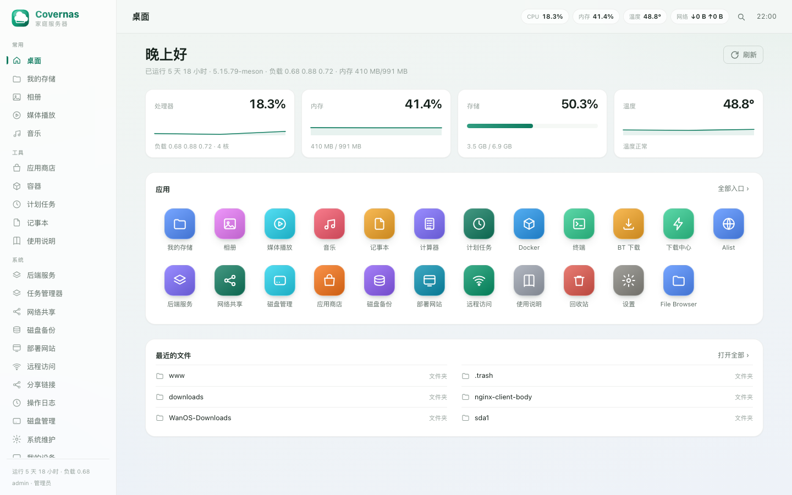
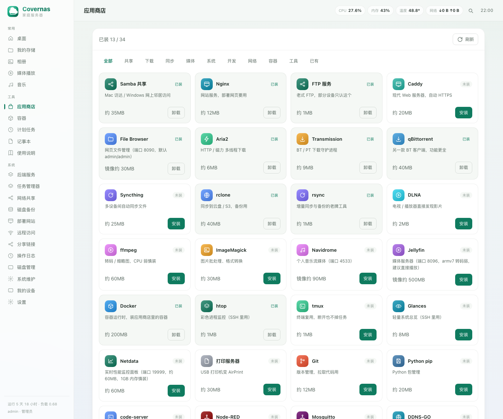
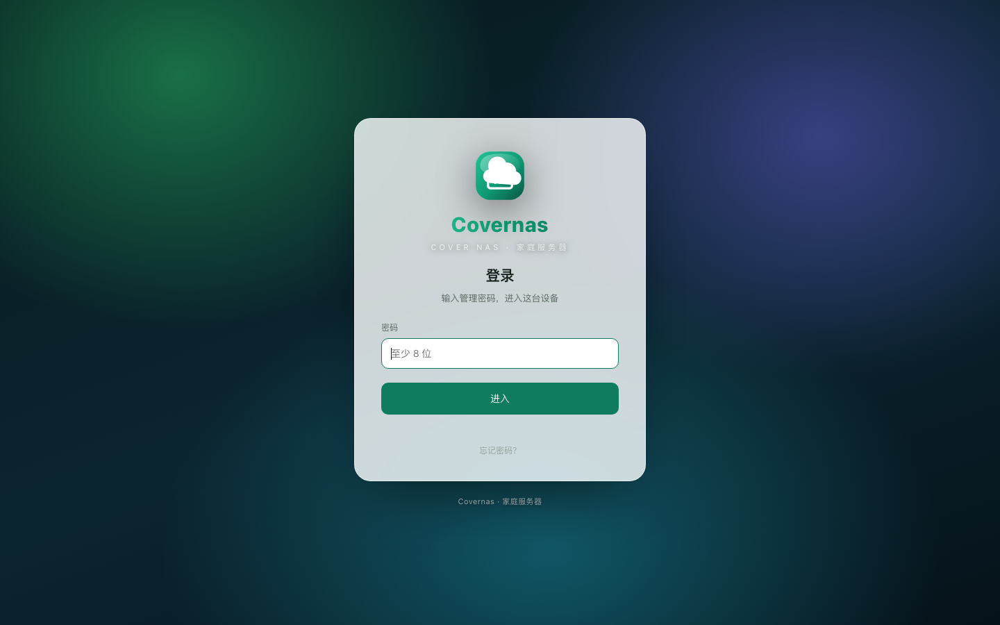

# Covernas

> 轻量级家庭 NAS 面板 · Python 标准库单文件后端 · 纯静态前端 · 适配 ARMv7 / 1GB 内存小主机

Covernas 是一个自建的家庭服务器管理面板。它不依赖任何 Web 框架、不引入第三方 Python 包、没有前端构建链——一个 `server.py` 加一组静态文件即可运行，专为低配 ARM 设备（Amlogic S805 / 1GB 内存 / 8GB eMMC）设计。





## 功能

| 分类 | 能力 |
|---|---|
| 文件 | 四种视图（列表/图标/分栏/画廊）、多选批量操作、重命名/新建、拖拽上传（带进度）、在线预览、压缩/解压、属性与权限、回收站、免登录分享链接 |
| 媒体 | 相册（三视图 + 灯箱 + 相册集合）、视频播放（倍速/续播/下一集）、音乐播放器（循环/随机/音量/列表） |
| 应用 | 应用商店 34 个应用（apt + Docker 两类，装完自动生成桌面入口）、Docker 容器管理（启停/日志/删除/新建） |
| 存储 | 磁盘与挂载管理、SMART 健康检查、磁盘备份（rsync 定时任务）、回收站 |
| 共享 | SMB 共享与用户、NFS 导出、FTP、WebDAV（rclone serve） |
| 网络 | 站点部署（nginx 站点一键生成）、远程访问（Tailscale / frp / ZeroTier / Cloudflare DDNS）、设备信息 |
| 系统 | 后端服务启停、任务管理器、计划任务（图形化 crontab）、系统维护（清理/更新/诊断/电源）、配置备份与恢复 |
| 安全 | 密码 PBKDF2（120k 次）、多账号（管理员 / 只读）、操作审计日志、恢复码重置密码 |
| 体验 | 全局搜索（Ctrl/⌘ + K 命令面板）、主题色与 14 套壁纸、深浅色、手机适配与 PWA、上传进度、温度告警 |

## 架构

```
covernas/
├── server.py              # 全部后端逻辑（标准库，单文件）
├── box.service            # systemd 单元
├── web/                   # 纯静态前端（无构建）
│   ├── index.html         # 单页应用骨架 + SVG 图标 sprite
│   ├── app.js             # 视图、请求、交互
│   ├── app.css            # 设计体系
│   ├── polish.css         # 视觉细节增强
│   ├── login.html         # 登录 / 初始化 / 恢复码重置
│   ├── manifest.webmanifest / sw.js / pwa-*.png   # PWA
│   ├── favicon.svg / qrcode.min.js
├── scripts/install-apps.sh  # 可选：安装 aria2 / samba / alist 等外部软件
└── docs/DEVELOPMENT.md      # 开发文档（架构、API、调试）
```

- **后端**：`http.server.ThreadingHTTPServer` + `BaseHTTPRequestHandler`，路由用 if 链；无 ORM，配置用 JSON 文件（`/etc/box/*.json`），审计写 JSON Lines。
- **前端**：原生 JS（ES5 风格 IIFE）+ DOM 操作，无框架、无打包；图标使用内联 SVG sprite，缺失图标自动退化为首字母色块。

## 快速开始

环境要求：Linux + systemd、Python 3.8+（不需要 pip 安装任何东西）。

```bash
# 1. 部署到设备
sudo mkdir -p /opt/box
sudo rsync -a ./ /opt/box/
sudo cp box.service /etc/systemd/system/box.service

# 2. 启动
sudo systemctl daemon-reload
sudo systemctl enable --now box

# 3. 打开浏览器
#    http://<设备IP>:9000  → 首次访问会引导设置管理员密码
```

可选：安装外部依赖（aria2 / Samba / Alist 等）

```bash
sudo bash /opt/box/scripts/install-apps.sh
```

反向代理（推荐公网使用时加 HTTPS）：

```nginx
location / {
    proxy_pass http://127.0.0.1:9000;
    proxy_set_header Host $host;
    proxy_set_header X-Real-IP $remote_addr;
}
```

## 数据与配置

| 路径 | 内容 |
|---|---|
| `/etc/box/` | 面板配置：账号（`users.json`）、外观（`ui.json`）、笔记、相册、分享、（`audit.log`）审计 |
| `/etc/box/recovery-key` | 恢复码（忘记密码时用，可在设置页或登录页查看提示） |
| `/mnt/` | 数据盘（面板的写操作只允许在 `/mnt` 下进行，系统目录只读保护） |
| `/opt/box/` | 代码目录 |

配置备份/恢复：面板「系统维护 → 配置备份与恢复」可导出/导入 tar.gz（不含密码与恢复码）。

## 认证与权限

- 首次访问进入初始化流程，创建管理员 `admin`。
- 设置页「账号管理」可添加账号，角色分 **管理员** 与 **只读**。
- 只读账号可浏览、播放、下载、查看日志，所有写接口返回 `403 {readonly:true}`。
- 所有写操作（登录、文件、服务、容器、配置）写入 `/etc/box/audit.log`，面板「操作日志」页可筛选查看。

## 安全提示

- 默认监听 `0.0.0.0:9000` 且无 TLS，请只在可信局域网使用；公网访问请用 nginx/Caddy 反代并启用 HTTPS。
- 首次部署后请立即修改默认密码，并妥善保管 `/etc/box/recovery-key`。
- 应用商店中的 Docker 应用默认数据卷落在 `/mnt/<应用名>`，卸载容器不会自动删除数据卷。

## API

主要接口（全部为 JSON，除特别说明）：

```
GET  /api/status /api/apps /api/files /api/photos /api/media /api/notes
GET  /api/services /api/storage /api/docker /api/store /api/sysinfo /api/search
GET  /api/audit /api/me /api/users /api/ui /api/shares /api/backup /api/site /api/remote
GET  /api/config/export（tar.gz 下载）
POST /api/login /api/setup /api/recover /api/logout /api/passwd
POST /api/mkdir /api/delete /api/rename /api/upload /api/files/move /api/file/*
POST /api/service /api/docker /api/store/install /api/cron /api/maintenance
POST /api/samba /api/nfs /api/ftp /api/webdav /api/users /api/config/import
```

完整接口与数据结构见 [docs/DEVELOPMENT.md](docs/DEVELOPMENT.md)。


## 刷机镜像

整机镜像（系统 + 面板 + 常用软件，开箱即用）随版本发布在 Release 里：

| 文件 | 说明 |
|---|---|
| `Covernas-1.1.0-onecloud.img.gz` | eMMC 全盘镜像（gzip 约 1.4 GB，解压 7.3 GiB），适配 Amlogic S805 / 1GB / 8GB eMMC |
| `SHA256SUMS` | 镜像校验值 |

- 刷机步骤、默认凭据、刷后检查清单：见 [docs/FLASHING.md](docs/FLASHING.md)
- 想从自己的设备导出一份可分发镜像：用 [scripts/extract-image.sh](scripts/extract-image.sh)（会先清理账号/密钥/私人数据）

## License

MIT © 2026 XCR
